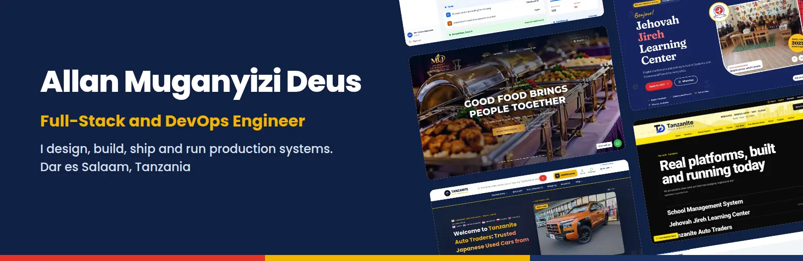

  
  
  
  

## About me

I'm a full-stack engineer who also owns what happens after the code is written: infrastructure, deployments, security and monitoring.

- **Right now:** I build and run the production platform of **Tanzanite Auto Traders**, a Japanese used car sales company (Tokyo HQ, East Africa Regional Office in Dar es Salaam).
- **Latest work:** a multi-school **School Management System**, and the website and school system of **Jehovah Jireh Learning Center** in Dodoma, joined by one login.
- **Member of [Tanzanite Tech Solutions](https://tech.tanzaniteauto.com):** a Tanzanian software company. I work on software and cloud engineering.
- **How I work:** typed code, small reviewed commits, infrastructure as scripts, nothing manual that a pipeline can do.
- **Stack:** web (Next.js, React), mobile (React Native, Flutter), backend (Node.js, Django), cloud (AWS, Docker, GitHub Actions).
- **Location:** Dar es Salaam, Tanzania. I speak and write English and Kiswahili.

<picture>
  <source media="(prefers-color-scheme: dark)" srcset="assets/dashboard-dark.svg"/>
  
</picture>

## Selected work

<a href="https://tech.tanzaniteauto.com/work">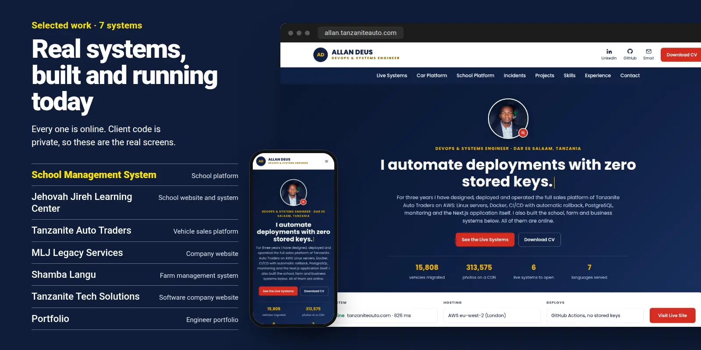</a>

Every system here is online and runs on infrastructure I set up. Client code is private, so these are the real screens; the school system and farm app show sample data.

 

<a href="https://shule.tanzaniteauto.com">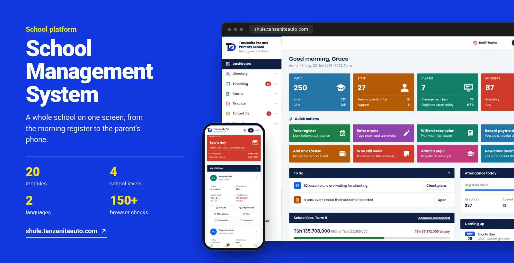</a>

  
  

One platform for many schools. Each school has its own badge, colours, sign-in page, levels, grading, fees and private data.

| | What I built |
|---|---|
| **Teaching and exams** | Registers on a phone, timetables with clash checks, lesson plans that follow the timetable and are checked by the Academic Teacher, marks saved while typing, NECTA grades, divisions and positions, a submit, approve and publish workflow, report cards with signatures |
| **Money** | Fee structures, one-click term invoices, numbered receipts, void with reason instead of delete, expenses, budgets with warnings, payroll with NSSF and PAYE, payslips and a bank list |
| **Families** | Parent portal for all children: attendance, results, report cards, fees, homework, timetable and events, in English and Kiswahili |
| **Trust** | Signed QR codes on every document that open the school's own record, 34 permissions with custom and double roles, two-step sign-in, idle sign-out, one year of activity log |
| **Live data** | Every change reaches every open screen in about a second through PostgreSQL LISTEN/NOTIFY and Server-Sent Events |
| **Quality** | More than 150 real-browser end-to-end checks driven over the Chrome DevTools Protocol |

Next.js 16 · TypeScript · PostgreSQL · Server-Sent Events · Docker · Amazon Lightsail and SES · GitHub Actions

<b>More screens of the school system</b>

 
<table>
  <tr>
    <td width="50%">
Class results
</td>
    <td width="50%">
Fee status by pupil
</td>
  </tr>
  <tr>
    <td width="50%">
Attendance today
</td>
    <td width="50%">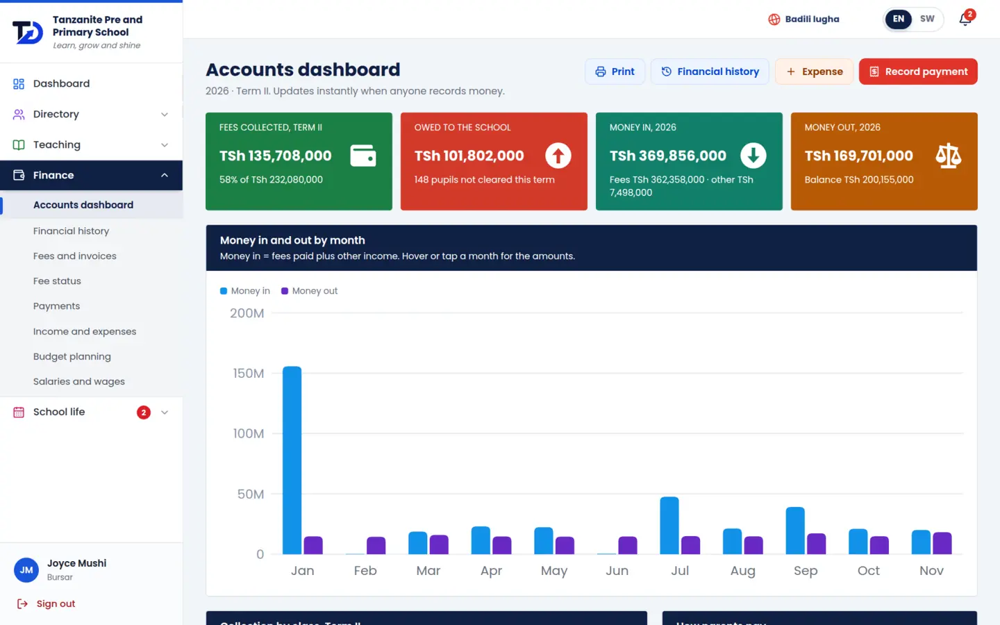
Accounts
</td>
  </tr>
  <tr>
    <td width="50%" align="center">
Report card
</td>
    <td width="50%" align="center">
What a QR scan opens
</td>
  </tr>
</table>

 

<a href="https://jehovahjirehlc.cc">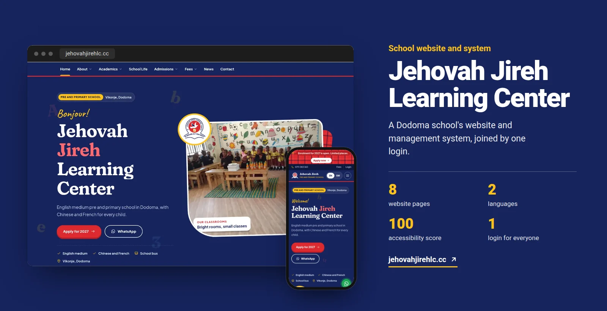</a>

  
  

The website and school system of an English medium pre and primary school in Vikonje, Dodoma.

| | What I built |
|---|---|
| **Website** | Eight pages in English and Kiswahili built on the school's own photos, uniform tartan and colours; fees and joining instructions, application form, greetings that speak in four languages; a manager where the school edits every text and photo |
| **School system** | The platform above in the school's badge and colours on its own sign-in address, with its real fee structure, report cards and emails in the school's name |
| **Joined** | One login for parents, teachers and staff, live pupil and staff numbers on the website, single sign-on from the system into the website manager |
| **Craft** | Badge redrawn as a clean vector from the school's own artwork; Lighthouse accessibility 100 on every page |

Next.js · TypeScript · PostgreSQL · Docker · Caddy · Amazon Lightsail

 

<a href="https://tanzaniteauto.com">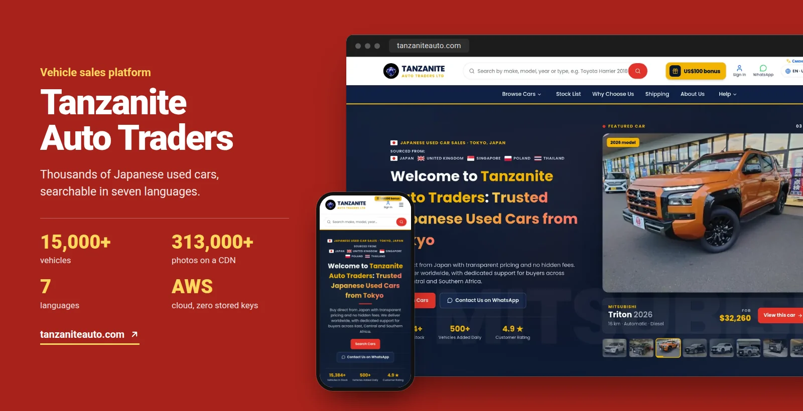</a>

  
  

A multilingual car sales platform with a public storefront and three portals (customer, staff, admin). I build it and run it in production.

<picture>
  <source media="(prefers-color-scheme: dark)" srcset="assets/architecture-dark.svg"/>
  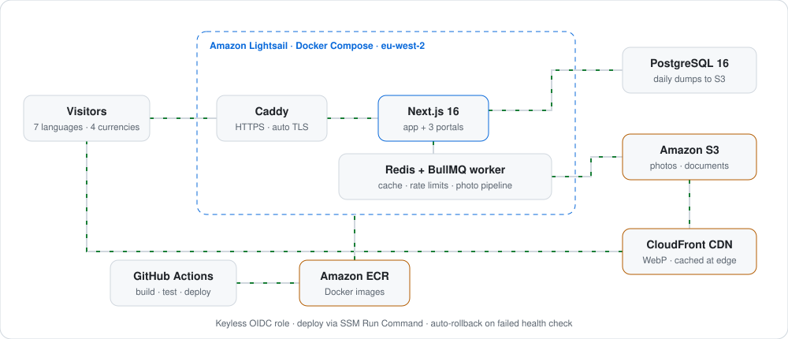
</picture>

| | What I built |
|---|---|
| **Product** | Storefront with smart search, filters and infinite scroll; customer accounts with orders and documents; staff portal with a photo pipeline (ZIP upload, WebP variants, watermarking); admin portal with reports, analytics, content editing and SEO controls |
| **Invoicing** | Replaced the sales team's Google Apps Script invoice system: numbered invoices with HS codes, PDF generation, email delivery to customers through Amazon SES, paid and overdue tracking, audit history; every legacy invoice and 384 audit events imported by a repeatable script; staff Android app (Capacitor) moved to the new system |
| **Delivery** | GitHub Actions builds a Docker image, pushes it to ECR and deploys through SSM; database migrations run automatically; a failed health check rolls back to the previous version |
| **Security** | Short-lived OIDC credentials (no long-lived AWS keys), least-privilege IAM, no open SSH port (SSM only), HSTS/CSP headers, rate limiting, role-based access |
| **Operations** | Daily server snapshots and database dumps to S3, health checks, query monitoring, and cost tuning (e.g. moving every system from EC2 and a hosted database to one server with about 1.5 minutes of downtime) |

Next.js · TypeScript · Prisma · PostgreSQL · Redis · Docker · AWS Lightsail, S3, CloudFront, IAM, SSM · GitHub Actions

 

<a href="https://mj.tanzaniteauto.com">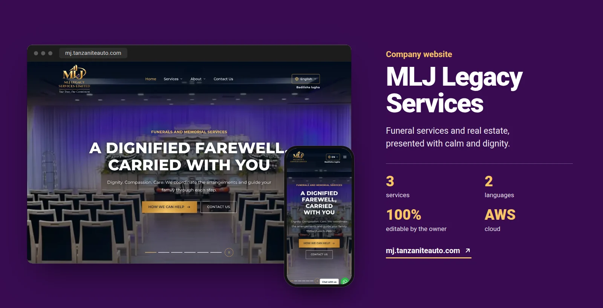</a>

  
  

Bilingual website for a Dar es Salaam funeral services and real estate company: full-screen photo stories, tombstone designs with quotation requests, an enquiries inbox and a manager where the owner edits every text and photo.

Next.js · TypeScript · PostgreSQL · Docker · AWS

 

<a href="https://d.tanzaniteauto.com">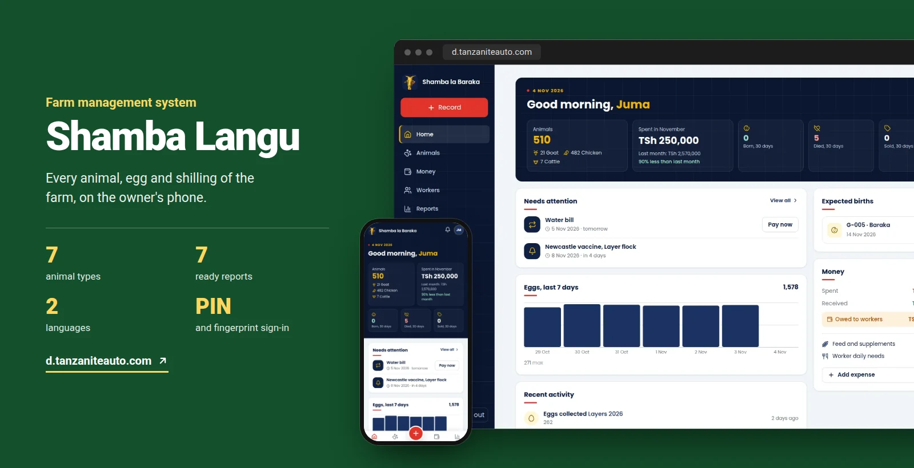</a>

  
  

Farm records for livestock owners: animals and flocks, births and breeding reports, eggs, expenses, budgets and worker pay. Installable, with PIN or fingerprint sign-in (WebAuthn), push reminders, English and Kiswahili.

Next.js 16 · PostgreSQL · PWA · WebAuthn · Web Push · AWS

 

<a href="https://tech.tanzaniteauto.com">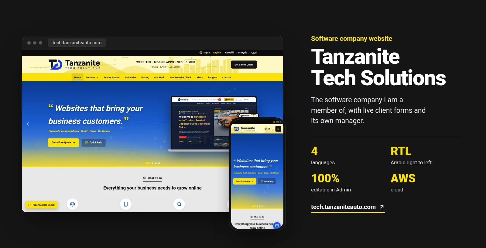</a>

  

Website of the software company where I am a member: four languages with Arabic right to left, a content manager, customer accounts, a website-check tool and client forms followed live. The "Our Work" page there is where this section's design comes from.

Next.js 16 · PostgreSQL · Docker · AWS

 

<a href="https://allan.tanzaniteauto.com">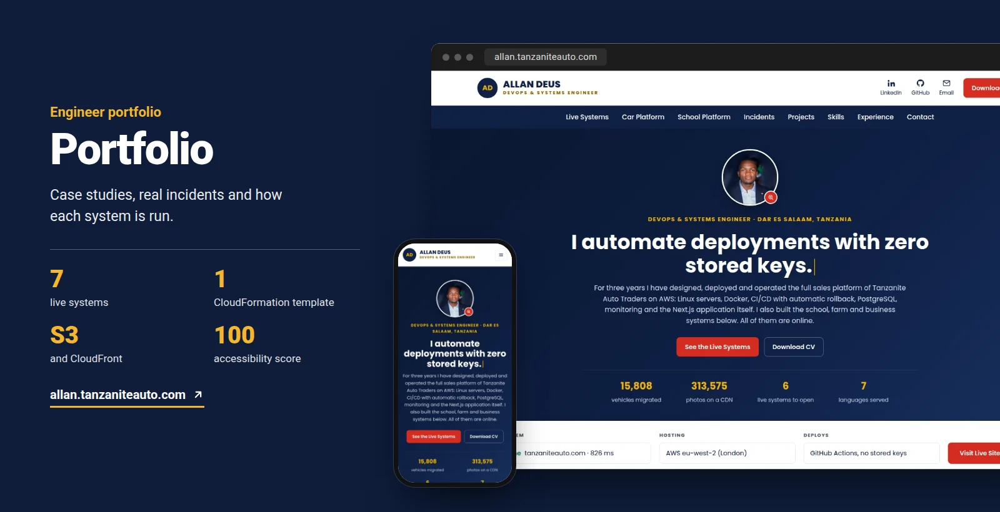</a>

  

Case studies, real incidents and how each system is run. A static site on S3 and CloudFront, built from one CloudFormation template.

HTML · CloudFormation · S3 · CloudFront · GitHub Actions

## More projects

| Project | What it is | Stack |
|---|---|---|
| **Tanzanite Invoice System** (private, production) | Invoicing inside the Tanzanite staff and admin portals, moved off Google Apps Script: PDF invoices, customer email delivery, payment tracking, audit history and an Android app for staff | Next.js · Prisma · Amazon SES · Capacitor |
| [**Meditrack**](https://github.com/allan818181/hospital-system) | Hospital system with five role-based portals: reception, doctor, lab, pharmacy, admin | Django · DRF |
| [**Vegas Hotel AI Concierge**](https://github.com/allan818181/vegas) | AI chat concierge grounded in a real hotel's suites and prices; captures bookings as leads | Node.js · Express · Gemini |
| [**Dar es Salaam Data Portal**](https://github.com/allan818181/dar-data-portal) | Open-data portal: datasets, a pandas/Matplotlib transform engine, REST API, PDF/Excel reports | Django · DRF · pandas |
| [**LBLS Library System**](https://github.com/allan818181/desktop-library-management-system) | Desktop library system: loans, fines, analytics, audit log, report builder | Python · Tkinter · PostgreSQL |
| [**Abode Harmony**](https://github.com/allan818181/property-management-system) | Landlord and tenant property management with receipts and maintenance requests | React · TypeScript · Supabase |
| [**Inventory System**](https://github.com/allan818181/inventory-frontend) | Full-stack inventory: JWT [REST API](https://github.com/allan818181/inventory-system-backend) + React dashboard | Django REST · React · TS |
| [**Salon Website**](https://github.com/allan818181/salon-web) | Bilingual (EN/SW) site, containerized for production | Django · Tailwind · Docker |
| [**CertifyWell**](https://github.com/allan818181/exam-portal) | Online exam portal with token-protected exams and grading | PHP · MySQL · JavaScript |

## Tech stack

| | |
|---|---|
| **Languages** |  |
| **Frontend & mobile** |   |
| **Backend & data** |  |
| **DevOps & cloud** |  |

## Activity

<picture>
  <source media="(prefers-color-scheme: dark)" srcset="https://raw.githubusercontent.com/allan818181/allan818181/output/snake-dark.svg"/>
  
</picture>

The dashboard and the snake above are rebuilt every day by a GitHub Actions workflow in this repository (<code>scripts/dashboard.mjs</code>), which also checks that each production system is online.

